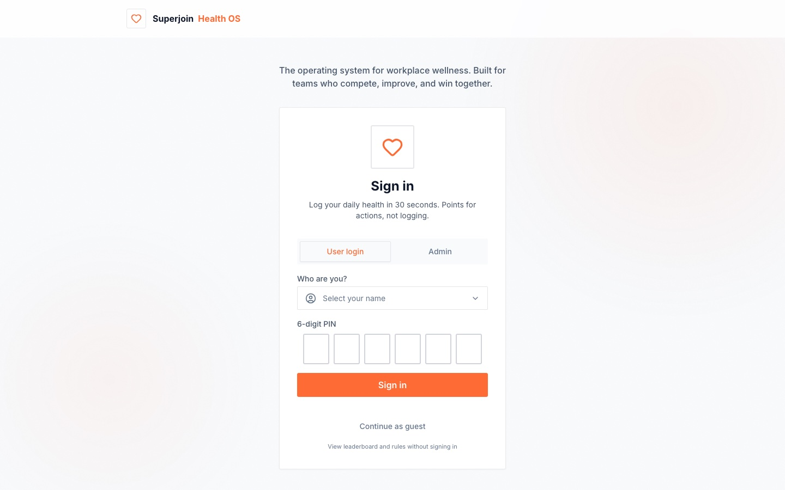
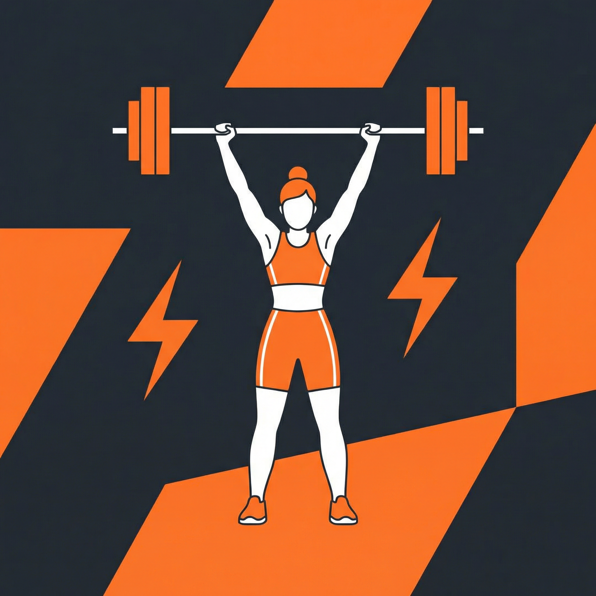
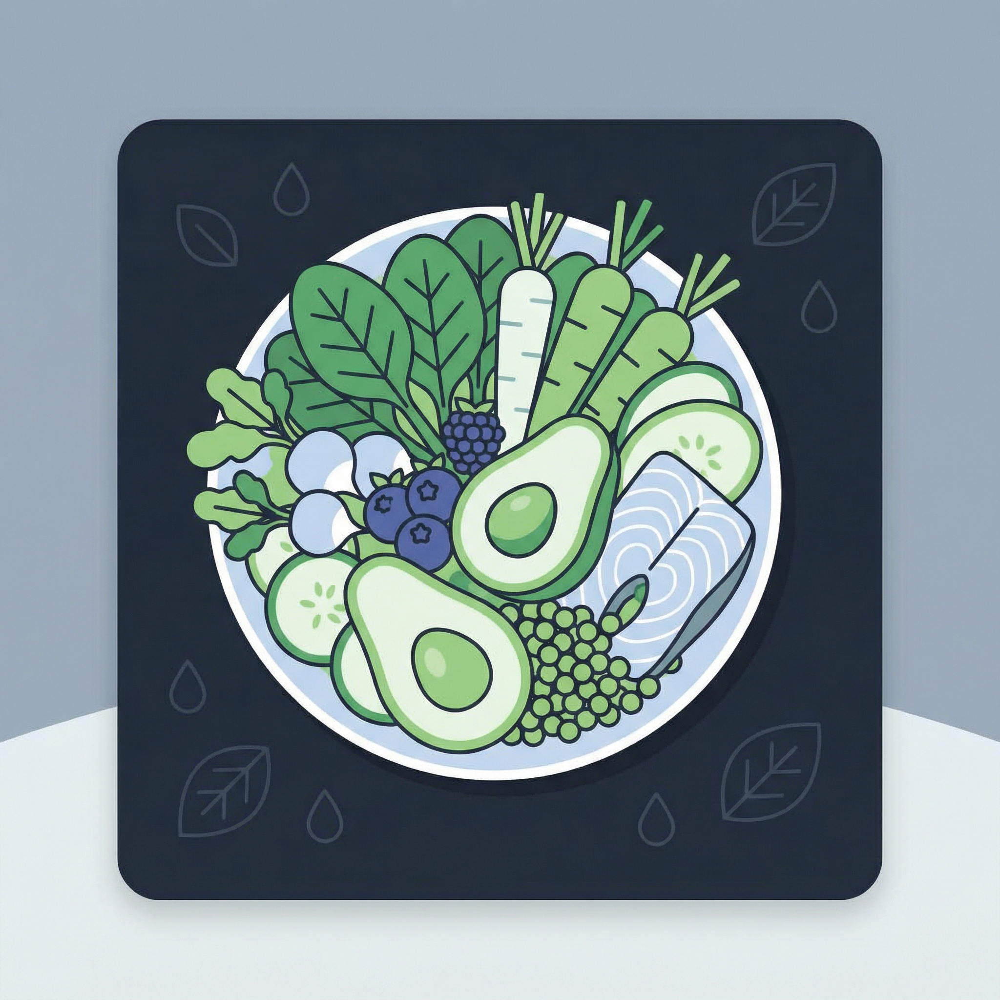
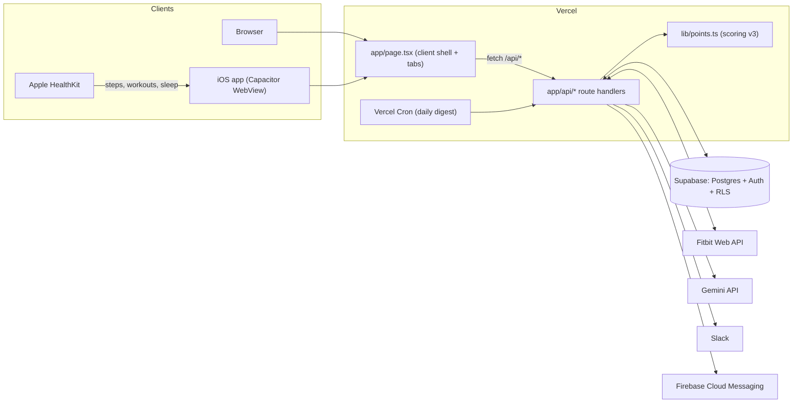

<p align="center"></p>

<p align="center">
  <a href="https://github.com/abhinav-adtechs/superjoin-health-league/actions/workflows/ci.yml"></a>
  <a href="LICENSE"></a>
  
  <a href="https://superjoin-health-league.vercel.app"></a>
  
  
  
</p>

<p align="center"><b>Log your day in 30 seconds, earn points for healthy actions, and compete with your team on a leaderboard that rewards effort — not who logs the most.</b></p>

<p align="center">
  <a href="#-features">Features</a> ·
  <a href="#-quick-start">Quick start</a> ·
  <a href="#-architecture">Architecture</a> ·
  <a href="#-docs">Docs</a> ·
  <a href="#-roadmap">Roadmap</a> ·
  <a href="#-contributing">Contributing</a>
</p>

<p align="center"></p>

## Why Office Health League?

Office fitness challenges usually reward whoever logs the most, or whoever already runs marathons. This app scores **effort across four categories** — workout, movement, sleep and nutrition — with a daily cap, age-adjusted thresholds for 35+, and an all-time ranking normalized by days since joining, so late joiners and people with different goals compete on equal terms. Every field is optional: you get points for healthy actions, not for filling in forms.

It runs as a Next.js web app on Vercel and as an iOS app (Capacitor) that can pull steps, workouts and sleep from Apple Health.

## ✨ Features

<table>
<tr>
<td width="50%" valign="top">

### 🏠 Dashboard

Today's goals, a **week-at-a-glance grid** (one column per day, one icon per goal), logging and goal-crush streaks, and your rank in the current month's league.

</td>
<td width="50%" valign="top">

### 📝 Health & activity log

Strength (body-part grid), cardio, steps, sleep (bedtime/wake dual-pin picker), water, food and weekly weigh-ins. Log today or up to 4 days back; clear a single activity without losing the rest of the day.

</td>
</tr>
<tr>
<td valign="top">

### 🍛 Food logging with AI parsing

Browse a catalog of 493 dishes (mostly Indian home and office food) with portion presets, or type _"2 rotis and dal for lunch"_ and let **Gemini** split it into catalog items. Calories and protein roll up into the day automatically.

</td>
<td valign="top">

### 🏆 Fair leaderboard

Weekly, monthly and all-time views. Weekly adds a goal bonus; all-time ranks by points **per day since joining**. Top-3 ladder, per-category breakdowns and "points to next rank" projections.

</td>
</tr>
<tr>
<td valign="top">

### ⚖️ Effort-based scoring (v3)

Duration gradients instead of yes/no checkboxes, mode-aware nutrition (75 or 90 pts/day cap), age-adjusted thresholds, plus logging-streak and goal-crush bonuses. Fully documented in [`docs/SCORING.md`](docs/SCORING.md).

</td>
<td valign="top">

### 🎯 Goal setup wizard

Pick a fitness goal (lose weight, gain muscle, gain weight, stay active, general wellness), workout focus, and daily targets for sleep, water, protein, calories and steps. The UI accent color follows your goal.

</td>
</tr>
<tr>
<td valign="top">

### 🔌 Integrations

**Fitbit** (OAuth, server-side sync) and **Apple Health** (HealthKit, via the iOS app). Choose whether synced data fills gaps or overrides manual logs. Google Health Connect is shown as _coming soon_.

</td>
<td valign="top">

### 🔔 Slack & reminders

Entry posts to a team channel, a daily **Slack digest** (month standings, overnight rank crossings, yesterday's MVP) via Vercel Cron, and per-user reminder DMs at a chosen local time (hook `/api/cron/daily-reminders` to a 5-minute scheduler).

</td>
</tr>
<tr>
<td valign="top">

### 🔐 PIN login & guest mode

Pick your name, enter a 6-digit PIN (bcrypt-hashed, rotates every 60 days). Admin signs in with email/password. Guests can view the leaderboard and rules without an account.

</td>
<td valign="top">

### 📱 iOS app

A Capacitor 7 shell that loads the deployed app in a WebView, with HealthKit entitlements and a Bearer-token API path for cookie-less sessions. See [`ios/README.md`](ios/README.md).

</td>
</tr>
</table>

Power-user touch: press <kbd>Ctrl</kbd> + <kbd>/</kbd> for the command palette.

<details>
<summary><b>Slack post artwork</b> (served from <code>public/slack/</code>)</summary>
<br>
<p>
  
  
</p>
</details>

## 🧰 Tech stack

**App** &nbsp;


**Data & hosting** &nbsp;


**Mobile** &nbsp;


**Integrations** &nbsp;


## 🏗 Architecture



Entry saves, food rollups and Fitbit/Apple Health syncs all recompute `daily_points` with the shared scoring engine on the server before writing, so the leaderboard, Slack posts and dashboard read the same number. The deep dive — modules, data model, auth flows and request lifecycle — lives in [`docs/ARCHITECTURE.md`](docs/ARCHITECTURE.md).

## 🚀 Quick start

**Prerequisites:** Node.js 20+ (CI uses Node 22), npm, and a [Supabase](https://supabase.com) project. Xcode 15+ and CocoaPods only if you want the iOS app.

```bash
git clone https://github.com/abhinav-adtechs/superjoin-health-league.git
cd superjoin-health-league
npm ci                        # .npmrc sets legacy-peer-deps (HealthKit plugin peer range)
cp .env.example .env.local    # then fill in the Supabase values
npm run dev                   # http://localhost:3003
```

**Database:** in the Supabase SQL editor, run [`supabase/schema.sql`](supabase/schema.sql), then the files in [`supabase/migrations/`](supabase/migrations) in filename (date) order. Step-by-step instructions, including users, PINs and cron, are in [`docs/DEPLOYMENT.md`](docs/DEPLOYMENT.md).

> [!TIP]
> `npm run build` succeeds without any environment variables, so you can verify a change compiles before wiring up Supabase. Hit `GET /api/health` on a running instance to check the Supabase connection.

<details>
<summary><b>All npm scripts</b></summary>

| Script                                                   | What it does                                                                             |
| -------------------------------------------------------- | ---------------------------------------------------------------------------------------- |
| `npm run dev`                                            | Next.js dev server on port 3003                                                          |
| `npm run build` / `npm start`                            | Production build / serve                                                                 |
| `npm run create-admin`                                   | Create the admin auth user + profile (`ADMIN_PASSWORD` required)                         |
| `npm run create-users`                                   | Create PIN-login users from the roster in `scripts/create-users.js` and print their PINs |
| `npm run run-pin-migration`                              | Apply the PIN-login migration via a direct Postgres URL                                  |
| `npm run seed-dummy-data` / `npm run cleanup-dummy-data` | Seed or remove demo entries (`SEED_DAYS`, default 90)                                    |
| `npm run recalculate-points`                             | Recompute stored `daily_points` for all entries                                          |
| `npm run cap:sync`                                       | Build, then `npx cap sync ios`                                                           |
| `npm run ios`                                            | Open the iOS project in Xcode                                                            |

`npm run lint` currently starts Next's interactive ESLint setup because no ESLint config is committed yet — see the roadmap.

</details>

## ⚙ Configuration

Copy [`.env.example`](.env.example) to `.env.local`. Only the first three variables are needed to run the core app.

| Variable                                                                 | Required    | Description                                                                                                                                 |
| ------------------------------------------------------------------------ | ----------- | ------------------------------------------------------------------------------------------------------------------------------------------- |
| `NEXT_PUBLIC_SUPABASE_URL`                                               | ✅          | Supabase project URL (alias: `NEXT_PUBLIC_HEALTH_LEAGUE_SUPABASE_URL`)                                                                      |
| `NEXT_PUBLIC_SUPABASE_ANON_KEY`                                          | ✅          | Supabase anon key (alias: `NEXT_PUBLIC_HEALTH_LEAGUE_SUPABASE_ANON_KEY`)                                                                    |
| `SUPABASE_SERVICE_ROLE_KEY`                                              | ✅ server   | Server-only key for leaderboard, PIN login, user list, cron (alias: `HEALTH_LEAGUE_SUPABASE_SERVICE_ROLE_KEY`). Never expose to the client. |
| `NEXT_PUBLIC_APP_URL`                                                    | Recommended | Deployed URL — used for Slack image links, Fitbit redirects and the Capacitor WebView                                                       |
| `CRON_SECRET`                                                            | Recommended | Bearer token required by `/api/cron/*` when set                                                                                             |
| `GEMINI_API_KEY`                                                         | Optional    | Enables "Generate using AI" food parsing                                                                                                    |
| `GEMINI_MODEL`                                                           | Optional    | Defaults to `gemini-2.5-flash-lite`                                                                                                         |
| `SLACK_WEBHOOK_URL`                                                      | Optional    | Incoming webhook for channel posts and the daily digest                                                                                     |
| `SLACK_BOT_TOKEN`                                                        | Optional    | Bot token for reminder DMs and user lookup by email                                                                                         |
| `FITBIT_CLIENT_ID` · `FITBIT_CLIENT_SECRET` · `FITBIT_REDIRECT_URI`      | Optional    | Fitbit OAuth app credentials                                                                                                                |
| `FIREBASE_PROJECT_ID` · `FIREBASE_CLIENT_EMAIL` · `FIREBASE_PRIVATE_KEY` | Optional    | Firebase Admin credentials for push                                                                                                         |
| `NEXT_PUBLIC_API_BASE_URL`                                               | Optional    | Absolute API base for native builds that aren't same-origin                                                                                 |
| `CAPACITOR_SERVER_URL` · `CAPACITOR_CLEARTEXT`                           | Optional    | Override the iOS WebView URL (e.g. `http://localhost:3003` + `true` for local dev)                                                          |

Admin scripts additionally read `SUPABASE_URL`, `HEALTH_LEAGUE_POSTGRES_URL_NON_POOLING` and `ADMIN_PASSWORD` — see [`scripts/README-admin-setup.md`](scripts/README-admin-setup.md).

> [!NOTE]
> The UI ships with its original workplace branding: app name in `app/layout.tsx` and `capacitor.config.ts`, accent color in `app/globals.css` / `tailwind.config.ts`, and the admin email in `components/LoginForm.tsx` and `scripts/`. Change those to make it yours.

## 📁 Project structure

```text
superjoin-health-league/
├── app/
│   ├── page.tsx              # Client shell: auth gate, tabs, sidebar, command palette
│   ├── layout.tsx            # Fonts, metadata, Vercel Analytics
│   └── api/                  # 35 route handlers: entries, leaderboard, food, water,
│                             #   weight, auth (PIN), integrations, notifications, cron
├── components/               # Dashboard, log, leaderboard, settings tabs + entry/, food/, water/
├── lib/
│   ├── points.ts             # Scoring engine v3 (single source of truth)
│   ├── supabase/             # Browser, server, service-role and Bearer-auth clients
│   ├── food/                 # Catalog matching, Gemini parsing, daily nutrition rollup
│   ├── integrations/         # Fitbit + Apple Health adapters and data mapping
│   └── slack.ts, push.ts     # Notification senders
├── supabase/
│   ├── schema.sql            # Base schema (run first)
│   └── migrations/           # Dated, incremental SQL
├── scripts/                  # Admin/user setup, seeding, scoring backfills
├── ios/                      # Capacitor iOS project (HealthKit)
├── food-catalog.csv          # 493-item food catalog source
├── prd.md                    # Original product requirements
└── points-system-v2-algorithm.md  # Scoring v2 spec (superseded by v3)
```

<details>
<summary>Legacy files in the repo root</summary>

`App.tsx`, `index.tsx`, `index.html`, `vite.config.ts`, `types.ts`, `metadata.json`, `services/`, `utils/`, `fix_function.sql`, `supabase_auth_setup.sql` and the match/standings components (`components/{Dashboard,Login,LoginDetails,MatchForm,MatchList,PlayerManager,Standings}.tsx`) are left over from the Vite app this project was forked from. They are not imported by the Next.js app; removing them is on the roadmap.

</details>

## 📚 Docs

| Doc                                                              | What's inside                                                    |
| ---------------------------------------------------------------- | ---------------------------------------------------------------- |
| [`docs/ARCHITECTURE.md`](docs/ARCHITECTURE.md)                   | Modules, request lifecycle, auth flows, data model, integrations |
| [`docs/SCORING.md`](docs/SCORING.md)                             | The v3 points engine with formulas, tiers, caps and bonuses      |
| [`docs/DEPLOYMENT.md`](docs/DEPLOYMENT.md)                       | Supabase setup, Vercel deploy, cron, Slack, Fitbit, iOS          |
| [`points-system-v2-algorithm.md`](points-system-v2-algorithm.md) | The v2 scoring spec and its rationale (historical)               |
| [`prd.md`](prd.md)                                               | Original product requirements                                    |
| [`ios/README.md`](ios/README.md)                                 | iOS app setup, HealthKit and signing                             |
| [`scripts/README-admin-setup.md`](scripts/README-admin-setup.md) | Admin user and PIN setup                                         |
| [`CHANGELOG.md`](CHANGELOG.md)                                   | Release history                                                  |

## 🗺 Roadmap

- [ ] Remove legacy Vite/match-tracker files left over from the fork
- [ ] Commit an ESLint config so `npm run lint` works in CI
- [ ] Unit tests for the scoring engine (`lib/points.ts`)
- [ ] Reuse `lib/points.ts` for Log tab point badges instead of duplicated tiers
- [ ] Finish native push notifications on iOS
- [ ] Google Health Connect (Android) integration
- [ ] Make admin email, member roster and app name configurable
- [ ] Consolidate Supabase SQL into CLI-friendly migrations and a seed

## 🤝 Contributing

Issues and PRs are welcome — start with [`CONTRIBUTING.md`](CONTRIBUTING.md) for setup, conventions and the PR checklist. Please follow the [Code of Conduct](https://github.com/abhinav-adtechs/.github/blob/main/CODE_OF_CONDUCT.md) and report vulnerabilities privately per the [security policy](https://github.com/abhinav-adtechs/.github/blob/main/SECURITY.md).

> [!NOTE]
> This project started as a fork of [fifa-league-tracker](https://github.com/abhinav-adtechs/fifa-league-tracker) (the two share git history up to 9 Feb 2026) and was rebuilt as a Next.js app on 20 Feb 2026.

## 📄 License

[MIT](LICENSE) © 2026 Abhinav Das

## Star history

<a href="https://star-history.com/#abhinav-adtechs/superjoin-health-league&Date"></a>

---

<p align="center">
  Built by <a href="https://github.com/abhinav-adtechs">Abhinav Das</a><br>
  <sub>If this project helped you, consider giving it a ⭐</sub>
</p>
