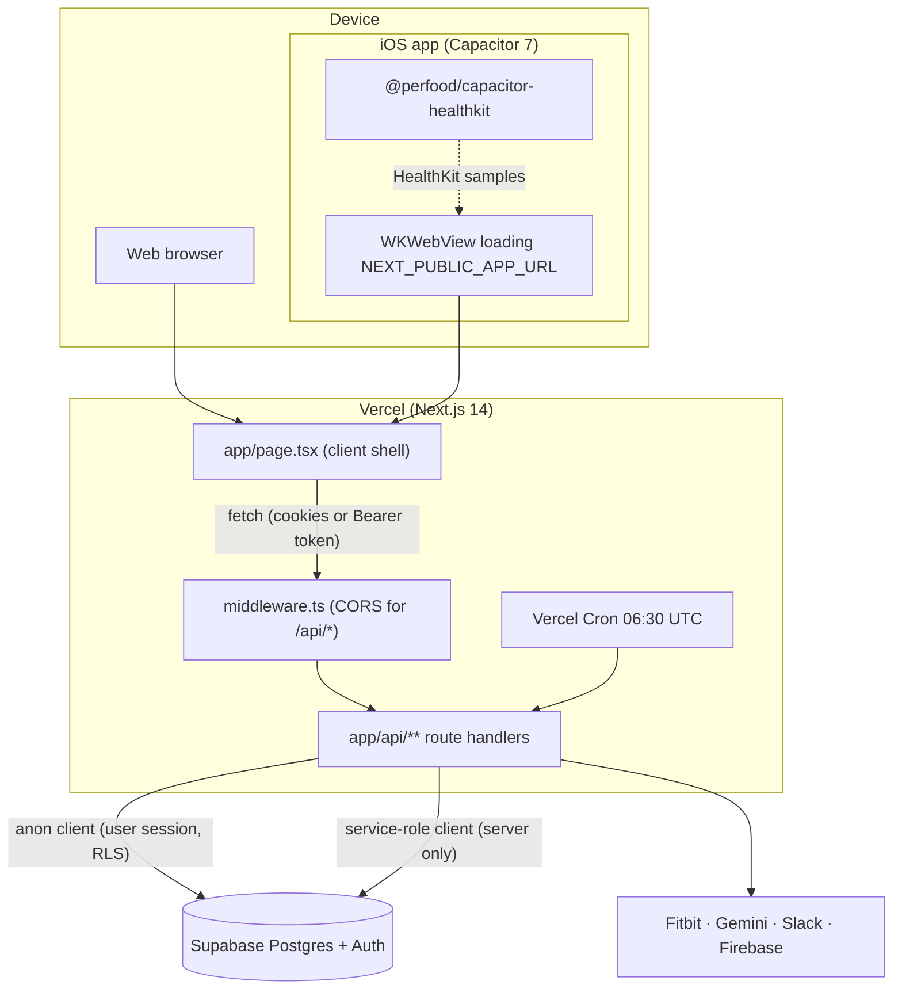
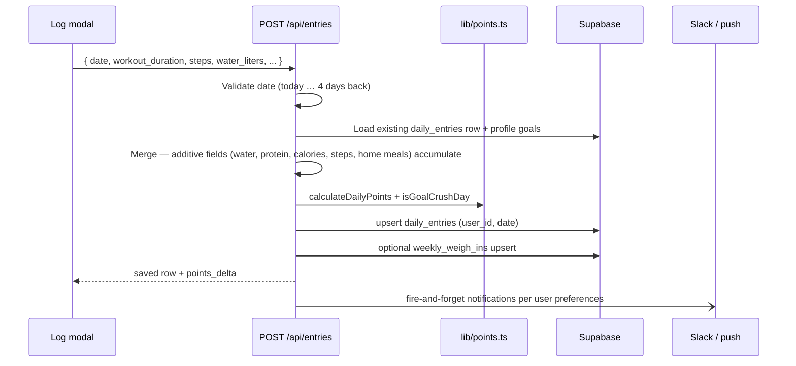
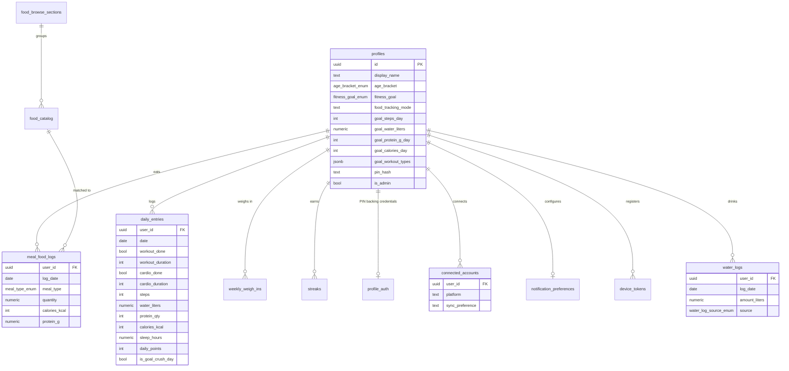

# Architecture

Office Health League is a single Next.js 14 (App Router) application. The UI is a client-rendered shell; all reads and writes go through route handlers under `app/api/`, which talk to Supabase (Postgres + Auth) and to optional third-party services. The same deployment backs the web app and the Capacitor iOS app.

## Contents

- [Runtime topology](#runtime-topology)
- [Code map](#code-map)
- [API surface](#api-surface)
- [Authentication](#authentication)
- [Request lifecycle: saving an entry](#request-lifecycle-saving-an-entry)
- [Data model](#data-model)
- [Integrations](#integrations)
- [Scheduled jobs](#scheduled-jobs)
- [Repository history](#repository-history)

## Runtime topology



- **Web and iOS share one deployment.** The iOS app is a native shell whose WebView loads the deployed URL (`capacitor.config.ts` → `server.url`), so API routes and auth cookies work same-origin. `webDir` is `public/`, which only holds a placeholder page.
- **CORS** (`middleware.ts`) allows `capacitor://localhost`, `localhost:3003` and `*.vercel.app` origins for `/api/*`, for builds that call the API cross-origin via `NEXT_PUBLIC_API_BASE_URL` (`lib/api.ts`).
- **Two Supabase clients.** Route handlers use the user's session (anon key + RLS) for their own data and a service-role client (`lib/supabase/admin.ts`) for cross-user reads such as the leaderboard, the login user list and cron jobs.

## Code map

| Path                                                                                   | Responsibility                                                                                                                                                                                          |
| -------------------------------------------------------------------------------------- | ------------------------------------------------------------------------------------------------------------------------------------------------------------------------------------------------------- |
| `app/page.tsx`                                                                         | Client shell: session bootstrap, goal-wizard gate, PIN-change gate, guest mode, sidebar/header, command palette (<kbd>Ctrl</kbd>+<kbd>/</kbd>). Tabs are code-split with `next/dynamic` (`ssr: false`). |
| `app/layout.tsx`                                                                       | Fonts (Inter, JetBrains Mono), metadata, Vercel Analytics                                                                                                                                               |
| `components/DashboardTab.tsx`                                                          | Today's goals, week-at-a-glance grid (`WeekGoalsGrid`), streaks, month league                                                                                                                           |
| `components/LogEntryTab.tsx`, `LogEntryModal.tsx`, `NewEntryCTA.tsx`                   | Log history calendar and the entry flows                                                                                                                                                                |
| `components/entry/*`                                                                   | Entry widgets: date carousel, workout body grid, sleep bed/wake picker, sliders, steps stepper, meal slots                                                                                              |
| `components/food/*`, `components/water/*`                                              | Food cart/composer with catalog search and AI parsing; water quick-add                                                                                                                                  |
| `components/LeaderboardTab.tsx`, `LeaderboardTopLadder.tsx`, `LeaderboardRowStats.tsx` | Weekly / monthly / all-time rankings                                                                                                                                                                    |
| `components/SettingsTab.tsx`                                                           | Profile & goals (`MyStatsTab`), notifications, connected apps                                                                                                                                           |
| `components/GoalSetupWizard.tsx`                                                       | First-run and edit flow for fitness goal and targets                                                                                                                                                    |
| `components/PointSystemPanel.tsx`                                                      | In-app rules and FAQ, backed by `/api/scoring-rules`                                                                                                                                                    |
| `lib/points.ts`                                                                        | Scoring engine v3 — see [SCORING.md](SCORING.md)                                                                                                                                                        |
| `lib/entryDateWindow.ts`                                                               | Logging window (today + 4 days back) and clear window (today + 2 days back)                                                                                                                             |
| `lib/clearEntryActivity.ts`                                                            | Clearing one activity from a day and recomputing points                                                                                                                                                 |
| `lib/food/*`                                                                           | Catalog matching, portion lexicon, Gemini parsing, meal inference, daily nutrition rollup                                                                                                               |
| `lib/integrations/*`                                                                   | Fitbit client, HealthKit adapter, mapping provider data to entry fields                                                                                                                                 |
| `lib/slack.ts`                                                                         | Block Kit builders, channel webhook posts, bot DMs, user lookup by email                                                                                                                                |
| `lib/push.ts`, `lib/push-client.ts`                                                    | Firebase Admin sender; native registration via the Capacitor bridge                                                                                                                                     |
| `lib/supabase/*`                                                                       | Browser, server (cookie), service-role and Bearer-token clients                                                                                                                                         |
| `lib/fitness-goal-theme.ts`, `lib/theme.ts`                                            | Goal-based accent theming                                                                                                                                                                               |
| `scripts/`                                                                             | Node scripts for admin/user setup, seeding and scoring backfills                                                                                                                                        |
| `supabase/`                                                                            | Base schema, dated migrations, one-off SQL helpers                                                                                                                                                      |

## API surface

All handlers live in `app/api/**/route.ts` (35 in total).

| Area           | Routes                                                                                                                                                 | Notes                                                                 |
| -------------- | ------------------------------------------------------------------------------------------------------------------------------------------------------ | --------------------------------------------------------------------- |
| Auth           | `POST /api/auth/pin-login`, `POST /api/auth/set-pin`, `GET /api/auth/callback`                                                                         | PIN sign-in and rotation; Supabase auth callback                      |
| Users          | `GET /api/users/list`, `GET·PUT /api/users/me`, `POST /api/users/setup`                                                                                | `list` is public and returns only users with a PIN (id, name, avatar) |
| Entries        | `GET·POST·PATCH /api/entries`, `GET /api/entries/history`                                                                                              | `POST` upserts a day, `PATCH` clears one activity                     |
| Food           | `GET /api/food/search`, `GET /api/food/sections`, `GET /api/food/recent`, `POST /api/food/parse`, `/api/food/logs`, `/api/food/logs/[id]`              | `parse` calls Gemini                                                  |
| Water & weight | `/api/water/logs`, `/api/water/logs/[id]`, `/api/weight`, `GET /api/weight/history`                                                                    | Weekly weigh-ins never add daily points                               |
| Dashboard      | `GET /api/dashboard/summary`, `GET /api/streaks/me`                                                                                                    |                                                                       |
| Leaderboard    | `GET /api/leaderboard?view=weekly\|monthly\|alltime`, `GET /api/leaderboard/projection`                                                                | Works for guests (service role)                                       |
| Scoring        | `GET /api/scoring-rules`                                                                                                                               | Reads `scoring_rules`, with a built-in fallback                       |
| Integrations   | `GET /api/integrations/status`, `/api/integrations/fitbit/{connect,callback,sync,disconnect}`, `POST·PATCH·DELETE /api/integrations/apple-health/sync` |                                                                       |
| Notifications  | `GET·PUT /api/notifications/preferences`, `POST /api/notifications/push/subscribe`, `POST /api/notifications/slack/link-user`                          |                                                                       |
| Cron           | `GET /api/cron/health-digest`, `GET /api/cron/daily-reminders`                                                                                         | Require `Authorization: Bearer $CRON_SECRET` when it is set           |
| Ops            | `GET /api/health`                                                                                                                                      | Checks Supabase env and connectivity                                  |

## Authentication

Three ways in, all ending in a normal Supabase Auth session:

1. **PIN login (members).** The login screen lists active users who have a PIN (`GET /api/users/list`). The member enters a 6-digit PIN:

   ```mermaid
   sequenceDiagram
     participant U as LoginForm
     participant R as /api/auth/pin-login
     participant DB as Supabase (service role)
     participant A as Supabase Auth
     U->>R: POST { profileId, pin }
     R->>DB: profiles.pin_hash, pin_set_at, must_change_pin
     R->>R: bcrypt.compare(pin, pin_hash)
     R->>DB: profile_auth (auth_email, auth_password)
     R->>A: signInWithPassword (server client sets cookies)
     R-->>U: { success, mustChangePin, pinExpired }
     Note over U: mustChangePin → SetPinForm → POST /api/auth/set-pin
   ```

   PINs are bcrypt-hashed in `profiles.pin_hash` and expire after 60 days. `profile_auth` holds the backing auth credentials; RLS denies all access to `anon` and `authenticated`, so only the service role can read it.

2. **Admin** signs in with email and password directly against Supabase Auth (`components/LoginForm.tsx`, admin mode). Admin setup is described in [`scripts/README-admin-setup.md`](../scripts/README-admin-setup.md).
3. **Bearer tokens.** Route handlers also accept `Authorization: Bearer <access token>` (`lib/supabase/bearer-auth.ts`) for clients that cannot rely on cookies.

**Guest mode** skips auth entirely and shows only the leaderboard and the rules panel.

## Request lifecycle: saving an entry



Food and water have their own log tables; after each change `lib/food/daily-rollup.ts` sums the day's logs back into `daily_entries` and rescores it, so the leaderboard only ever reads `daily_entries`.

## Data model

Base tables come from `supabase/schema.sql`; later features arrive through `supabase/migrations/`.



The diagram shows the columns that drive scoring; see the SQL for the full set. `scoring_rules` is a standalone documentation table that powers the in-app Point System panel; the canonical logic stays in `lib/points.ts`.

Row Level Security lets users read and write only their own rows, while authenticated users can read all profiles for the leaderboard.

## Integrations

| Integration           | Direction        | How                                                                                                                                                                                                           |
| --------------------- | ---------------- | ------------------------------------------------------------------------------------------------------------------------------------------------------------------------------------------------------------- |
| **Fitbit**            | Pull             | OAuth via `/api/integrations/fitbit/connect` → `callback`; tokens stored in `connected_accounts`; `sync` maps activity, sleep and water into `daily_entries` (`lib/integrations/fitbit.ts`, `data-mapper.ts`) |
| **Apple Health**      | Push from device | The iOS app reads steps, workouts, sleep, water, protein and body mass via HealthKit (`lib/integrations/apple-health.ts`) and posts them to `/api/integrations/apple-health/sync`                             |
| Sync preference       | —                | Per connection: _Fill empty only_ or _Always override_ manual values                                                                                                                                          |
| **Gemini**            | Request/response | `POST /api/food/parse` turns free text into catalog line items with meal type and portion (`lib/food/gemini-parse.ts`, model fallback list)                                                                   |
| **Slack**             | Push             | Incoming webhook for channel posts and the digest; bot token for DMs and email lookup (`lib/slack.ts`)                                                                                                        |
| **Push**              | Push             | `firebase-admin` sends to tokens in `device_tokens` (`lib/push.ts`). The native push plugin is not yet installed in the iOS project.                                                                          |
| Google Health Connect | —                | Listed in the UI as coming soon                                                                                                                                                                               |

## Scheduled jobs

| Job                         | Schedule                                  | Purpose                                                                                                                             |
| --------------------------- | ----------------------------------------- | ----------------------------------------------------------------------------------------------------------------------------------- |
| `/api/cron/health-digest`   | `30 6 * * *` in `vercel.json` (12:00 IST) | Posts month standings, yesterday's rank crossings, MVP and team pulse to Slack; posts a "ghost town" message if nobody logged       |
| `/api/cron/daily-reminders` | Not scheduled in `vercel.json`            | Designed to run every 5 minutes; sends Slack DM / push reminders to users whose reminder time matches the current UTC time (±2 min) |

## Repository history

The repository began as a copy of [fifa-league-tracker](https://github.com/abhinav-adtechs/fifa-league-tracker) — the first nine commits (5–9 Feb 2026) are shared. On 19 Feb 2026 it was rebranded, and on 20 Feb 2026 the Next.js app (`app/`, `lib/`, `supabase/`) was added alongside the old Vite files, which remain in the root but are not imported by the Next.js app. See [CHANGELOG.md](../CHANGELOG.md) for the full timeline.
